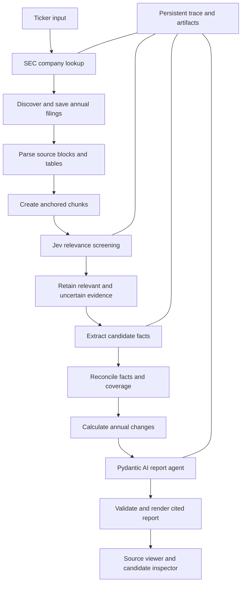

# ProfitLab: implementation specification

> **Historical specification:** this document records the completed first implementation through T13. Active work begins at T14 and is governed by [V2_IMPLEMENTATION_PLAN.md](V2_IMPLEMENTATION_PLAN.md) and [TASKS.md](TASKS.md). New work does not preserve old run-data compatibility.

Planning baseline: 2026-09-17. Audience: GPT-5.6 implementing one task per turn. This document specifies intended behavior; it does not claim the application or integrations have been built or tested. The execution order and checks are in [TASKS.md](TASKS.md). Resume instructions are in [PROGRESS.md](PROGRESS.md).

## 1. Product and boundaries

Build a local research application that answers:

> How did this company's earnings attributable to common shareholders and diluted earnings per share change over its latest four available fiscal years, and what explanations appear in its annual filings?

The user enters a ticker. The application resolves the company, downloads annual filings, screens document chunks with Jev, retains multiple evidence candidates, extracts figures, reconciles them, computes growth, and writes a report. The user can inspect every figure and every observable model/tool action without opening a debugger.

Use the product label **Earnings growth report**. Include the short explanation “Company earnings per share; stock-price returns are not included.” Actual shareholder investment return, portfolio analysis, stock-price data, forecasting, and audit opinions are outside this experiment.

### First-version support

- SEC companies with 10-K annual reports and usable HTML financial statements.
- Up to four latest distinct completed fiscal years; fewer years are acceptable and visible.
- Reported annual GAAP figures. Keep adjusted/non-GAAP candidates visible but exclude them from the main series.
- Exact company/security identification. Multiple tickers can map to one CIK. Different share classes must not be silently combined.
- Currency and fiscal dates are explicit. Do not silently convert currencies or assume December fiscal year ends.
- For ambiguous share classes, difficult EPS adjustments, unsupported filings, or unreadable tables, produce a partial result with a precise limitation.
- 20-F, 40-F, ETFs, PDF-only/OCR sources, full XBRL taxonomy processing, and financial audit judgments are deferred. Return “unsupported filing type” separately from “ticker not found.”

### Required human verification loop

Within two clicks of a reported number, show the source table with the correct row and year column highlighted. Alongside it show the exact reported value, units, row label, fiscal dates, filing identity, and a link to the SEC original. Within one click of a trace event, show its full redacted request and result.

The principal acceptance criterion is inspectability. A polished summary with missing provenance is a failed implementation.

## 2. Architecture and chosen stack

Use Python 3.12 initially unless locked dependencies require a documented change. Use `uv` with a committed `uv.lock`. Select mutually compatible current package versions in T01 and record them; later tasks must use the installed APIs instead of copying examples from a different release.

| Responsibility | Choice |
| --- | --- |
| Packaging and execution | uv, `src/` package layout, `profitlab` console entry point |
| Data contracts and settings | Pydantic v2 and pydantic-settings |
| Generative agents | Pydantic AI with its OpenAI provider support |
| Generative transport | Explicit OpenAI-compatible Chat Completions configuration |
| Relevance judgments | TypeSafe Jev `/v1/systemone`, separate HTTP adapter |
| HTTP and retries | httpx; bounded application retries with observable attempts |
| HTML parsing | lxml; preserve table and inline-XBRL structure |
| CLI | Typer and Rich |
| Local interface | FastAPI, Uvicorn, Jinja2, small locally served CSS/JavaScript |
| Persistence | SQLite from the standard library for indexes; immutable JSON/HTML artifacts on disk |
| Tests | pytest, pytest-asyncio, httpx mock transports, browser smoke checks where available |
| Lint | Ruff |

Do not add a vector database, external job queue, cloud tracing requirement, agent framework beyond Pydantic AI, or frontend build tool to the initial version. These are unnecessary for four reports and make task verification harder.

Use an explicit asynchronous Python pipeline with persisted stage boundaries. The application decides the processing order. Pydantic AI handles extraction fallbacks and the report-writing agent. Jev screens evidence and assists bounded evidence judgments. These roles must be distinguishable in the trace.



### Proposed project layout

```text
pyproject.toml
uv.lock
.python-version
.env.example
.gitignore
README.md
docs/
  IMPLEMENTATION_PLAN.md
  TASKS.md
  PROGRESS.md
  VERSIONS.md                  # created in T01
  USER_GUIDE.md                # created in T16
src/profitlab/
  cli.py
  settings.py
  contracts/                  # identity, source, facts, reports, trace
  storage/                    # SQLite repository and artifact store
  trace/                      # recorder, redaction, model adapter
  providers/                  # Jev, OpenAI-compatible model factory, fake providers
  sec/                        # lookup, submissions, download, rate limiter
  documents/                  # parse, source mapping, tables, inline XBRL, chunking
  pipeline/                   # stages, state machine, resume/cancel
  analysis/                   # screening, extraction, reconciliation, calculations
  agents/                     # extraction agent and report agent
  prompts/                    # versioned prompt text and Jev questions
  web/
    app.py
    templates/
    static/
  evaluation/                 # chunk benchmark and quality measurements
tests/
  fixtures/synthetic/
  fixtures/recorded/           # small provenance-documented SEC/provider samples
  unit/
  integration/
  task_gates/                 # test_t01.py ... test_t16.py
data/                         # ignored runtime output
  cache/sec/
  runs/<run_id>/
    manifest.json
    events.jsonl
    conversations/
    requests/
    sources/
    parsed/
    chunks/
    screening/
    candidates/
    selected/
    calculations/
    report/
    checks/
```

Do not create empty implementation modules merely to match this tree. Introduce modules as their tasks require them.

## 3. Configuration and execution modes

Use typed settings. Never put real credentials into a fixture, progress file, report export, terminal output, or browser response.

```dotenv
PROFITLAB_DATA_DIR=./data
PROFITLAB_HOST=127.0.0.1
PROFITLAB_PORT=8000
SEC_USER_AGENT=ProfitLab/0.1 your-real-contact-email@example.com
SEC_REQUESTS_PER_SECOND=2
TYPESAFE_API_KEY=
TYPESAFE_BASE_URL=https://api.typesafe.ai
TYPESAFE_MODEL=jev-latest
LLM_BASE_URL=https://api.openai.com/v1
LLM_API_KEY=
LLM_MODEL=gpt-5.6-luna
LLM_OUTPUT_MODE=tool
JEV_CONCURRENCY=2
LLM_CONCURRENCY=1
CHUNK_TARGET_TOKENS=1500
CHUNK_OVERLAP_TOKENS=180
MAX_HTTP_ATTEMPTS=3
```

The SEC contact placeholder is not a usable identity; `doctor --live sec` must require a real configured value. Follow the SEC's published fair-access policy: the proposed two-requests-per-second default stays below its currently documented ten-per-second ceiling. Use one shared limiter for every SEC request, including retries. Cache the ticker map and source downloads. [SEC developer resources](https://www.sec.gov/about/developer-resources)

Three explicit modes:

1. `demo`: synthetic fixtures and fake providers; no network or credentials. Header badge “Synthetic demo.”
2. `replay`: saved source/provider artifacts; no network. Header badge “Recorded replay,” original run/date/model visible.
3. `live`: actual configured services. Header badge “Live run,” showing individual service status and timestamps.

Never silently substitute a fake provider after a live failure. Offline replay of a real run is not a new live measurement. Fixture values must never appear under a real ticker unless clearly identified as synthetic test data.

### Command contract

Implement commands gradually according to TASKS.md:

```sh
uv run profitlab serve
uv run profitlab doctor
uv run profitlab doctor --live sec
uv run profitlab doctor --live jev
uv run profitlab doctor --live llm
uv run profitlab demo --through T08 --run-id demo-t08
uv run profitlab demo --through T10 --scenario conflict --run-id conflict-t10
uv run profitlab analyze AAPL --years 4 --mode live
uv run profitlab inspect <run-id>
uv run profitlab resume <run-id>
uv run profitlab cancel <run-id>
uv run profitlab verify <run-id>
uv run profitlab export <run-id> --output ./exports
uv run profitlab evaluate chunks --dataset evaluation/dev.json
```

`demo --through TNN` executes the deterministic fixture scenario as far as capabilities available at task TNN. It must use actual implemented pipeline code with fixture providers, not fabricated result files. For infrastructure-only tasks, it exercises that infrastructure against the latest implemented stage. Always print the run ID and browser URL. Reject unsupported future tasks clearly.

Do not overwrite an existing run ID. Reopening a run is read-only; rerunning a demo requires a fresh ID or a separately documented, explicitly requested replacement operation.

## 4. User interface contract

The interface must run from T01 onward and grow with each task. Early pages show “Not implemented yet” for unavailable stages; do not pretend those stages completed.

### Routes

| Route | Purpose |
| --- | --- |
| `/` | Ticker entry, run mode, recent runs, configuration readiness |
| `/runs/{run_id}` | Stage progress, status, elapsed time, coverage, errors |
| `/runs/{run_id}/sources` | Downloaded filings and provenance |
| `/runs/{run_id}/sources/{filing_id}#block-{block_id}` | Sanitized source document at a stable local anchor |
| `/runs/{run_id}/chunks` | Chunk text, boundaries, table metadata, token estimates, Jev decisions |
| `/runs/{run_id}/candidates` | Competing facts, selected/rejected/unresolved decisions |
| `/runs/{run_id}/calculations` | Inputs, formula, result, and source references |
| `/runs/{run_id}/report` | Final or clearly marked partial earnings report |
| `/runs/{run_id}/trace` | Timeline plus agent conversation and expandable calls |
| `/runs/{run_id}/checks` | Mechanical verification outcomes and limitations |
| `/evaluations/{evaluation_id}` | Chunk benchmark comparisons and missed evidence |

Use tabs for Overview, Report, Evidence, Chunks, Candidates, Calculations, Trace, and Checks. Tabs can initially be disabled. A browser refresh during a run must preserve progress. Poll the run index/events with `after_sequence` approximately once per second; server-sent events are optional later. Do not require streaming tokens for the first version.

### Evidence drawer

Clicking a report value opens a drawer containing:

- Company name, ticker, CIK, fiscal year and exact period dates.
- Metric definition; raw reported text; normalized value and units.
- Table title, row label, column label, relevant footnotes.
- The table excerpt with the row AND year column highlighted.
- “Open saved source” and “Open SEC original.”
- Filing form, filing date, accession, source hash, and extraction method.
- Other candidates and the selection decision.
- “View calculation” for a derived growth number.

Clicking an explanatory sentence opens its supporting passage and says “Management explanation” or “Analyst interpretation.” These labels convey provenance; they do not claim an interpretation has been independently established as true.

### Trace viewer

Provide both views:

1. Timeline: every pipeline operation, provider request, retry, validation failure, cache hit, and selection decision.
2. Conversation: actual Pydantic AI system/instruction context, user inputs, assistant messages, tool calls, tool results, and final output, grouped by agent run.

Filters: stage, agent, event kind, provider, error only, tool name. Search by candidate, chunk, citation, or call ID. Expand to full redacted JSON, with a copy button and linked artifacts. Large payloads may be folded or paginated; the complete payload remains accessible.

## 5. Core Pydantic contracts

Define schemas before building the pipeline. Persist `schema_version` and stable IDs. Use timezone-aware UTC timestamps, `date` for fiscal boundaries, `Decimal` for financial arithmetic, and JSON decimal strings for persistence. Avoid binary floating-point financial calculations. Model probabilities and timing can be floats.

The following are minimum fields, not literal code to paste without considering relationships.

| Contract | Required information |
| --- | --- |
| `RunManifest` | run ID, mode, ticker input, resolved company, requested year count, actual covered years, status/stage, timestamps, redacted configuration snapshot, code/prompt/schema/parser versions, provider model IDs, artifact references |
| `CompanyIdentity` | normalized ticker, SEC name, ten-digit CIK, exchange if known, other mapped tickers, lookup source and time |
| `FilingRecord` | filing ID, CIK, accession, form, report date, filing date, primary document URL, amendment relationship if known, fetch status, original bytes hash |
| `SourceBlock` | stable block ID, filing ID, DOM locator/original anchor if available, heading path, block kind, text, table ID if applicable, printed page label if explicitly found, block ordinal |
| `TableCell` | table/row/column IDs, raw text, normalized text, row/column spans, linked year/unit/header cells, inline-XBRL fact references |
| `Chunk` | chunk ID, filing ID, ordered block references, primary versus overlap block references, text with heading/table headers, token estimate and estimator version, source anchors |
| `ScreeningDecision` | chunk ID, Jev question/prompt version, probabilities by question, keep/uncertain/drop, reasons generated by rules, provider call ID, actual model, token usage |
| `EvidenceRef` | evidence ID, filing/block/table/cell IDs, original URL/anchor, local anchor, exact source text segments, normalized match offsets, page label if known, source hash |
| `FactCandidate` | candidate ID, metric enum, raw label, raw numeric text, Decimal value, currency/unit/scale, period, annuality, GAAP basis, consolidated/segment scope, attribution, share class, extraction method, source refs, validation results |
| `CandidateGroup` | comparable metric/period/unit/scope/class key, candidate IDs, selected ID if any, duplicate groups, selection reasons, unresolved conflicts, latest-comparative relationship |
| `AnnualObservation` | fiscal period, selected facts by metric, missingness reasons, comparability flags, supporting evidence IDs |
| `Calculation` | calculation ID, formula/version, ordered input IDs, Decimal results, applicability status, rounding/display policy |
| `ReportSentence` | sentence ID, text/template, kind, referenced fact/calculation/evidence IDs, attribution, validation state |
| `Report` | company and period coverage, structured summary, sentence list, table fact/calculation IDs, limitations, source index, validation status |
| `TraceEvent` | event ID, sequence, run/span/parent IDs, event kind, actor/stage/tool/call ID, UTC time, duration if complete, attempt, status, request/result artifact refs, safe summary, error fields |

Use enums for supported metrics: `net_income_common`, `net_income_parent`, `net_income_consolidated`, `eps_diluted`, `weighted_average_shares_diluted`. The last two net-income alternatives may provide context but must not be silently relabeled as common-share earnings.

Use explicit null/status values for `missing`, `not_applicable`, `unsupported`, and `conflicting`. Zero is a valid financial value, not a missing-data marker. Do not use a single nullable float to represent all these states.

Contract validators should reject invalid probability ranges, zero-length fiscal intervals, unknown reference IDs, inconsistent units, invented source anchors, and finalized report tables referencing unselected candidates. Store incomplete extraction attempts separately rather than coercing invalid data into valid candidates.

## 6. Trace and persistence requirements

### What must be captured

- User ticker request, execution mode, and effective redacted settings.
- Each pipeline stage start/end/failure and its artifact inputs/outputs.
- Every SEC call: URL, safe request metadata, response status, attempt, cache status, duration, content hash, and saved response reference.
- Every Jev call: complete state, questions/rubrics, model requested/returned, complete answer, usage, retry/error information.
- Every LLM call: effective instructions, message history sent, available tool schemas, generation settings, returned messages/tool calls, structured output, validation/retry prompts, usage when supplied.
- Each actual tool invocation: name, parsed arguments, raw argument string when supplied, call ID, parent model request, exact redacted result, time and exception if any.
- Each evidence selection/rejection: rule ID and short factual reason, linked competing candidates.
- Each calculation: exact inputs, formula, result and formatting.

Full trace means **observable interaction**, not private chain-of-thought. Do not ask a model to reveal hidden reasoning or invent a transcript for deterministic operations. A rule explanation such as “Rejected because the period is quarterly” is useful and sufficient. Pipeline service calls must be labeled `pipeline`; only calls requested by an agent are labeled `agent_tool`.

Pydantic AI exposes message-history serialization and run events. Use its supported event/message APIs for the installed release, preserve native serialized messages, and map them to the application's event model. Final history alone is insufficient because interrupted runs need partial traces too. [Pydantic AI message history](https://ai.pydantic.dev/message-history/) [Pydantic AI agent events](https://ai.pydantic.dev/agents/)

### Recording design

- One `TraceRecorder` interface is used by services, tool wrappers, and agent hooks.
- Persist an event before executing a side effect. Persist completion or failure afterward with the same span/call IDs.
- Store large payloads as content-addressed artifacts; event records contain their hashes/paths. Persist complete redacted payloads, not only snippets.
- Serialize event writing through one recorder queue/lock per process and use a unique monotonic sequence per run. Parallel operations must not interleave JSON lines.
- Use SQLite transactions for indexes. Write artifact files through temporary files and atomic rename.
- On process restart, reconcile incomplete spans as interrupted; tolerate and flag a truncated final JSONL line. Never rewrite an interrupted run as successful.
- Trace redaction happens before disk write, logging, or browser rendering. Redact authorization headers, API keys, cookies, URL credentials, and configured secret values even when echoed in errors. Preserve benign financial source content.
- No required external telemetry account. Optional Logfire can be added later, with explicit configuration.

### Example event relationship

```text
run demo-t12
  pipeline: download filing
    HTTP attempt 1 -> status 200 -> source artifact
  pipeline: screen chunk ch-014
    Jev request j-007 -> four Noul answers -> screening decision
  agent: report_writer, agent-run ar-003
    model request m-001 -> assistant tool call tc-001
      tool get_evidence(evidence_ids=[...]) -> table/passage references
    model request m-002 -> structured Report draft
    output validator -> missing citation -> retry message
    model request m-003 -> accepted Report
```

This example illustrates structure only. A real trace must display only calls that actually occurred.

## 7. SEC discovery and source acquisition

1. Trim and uppercase ticker input, applying a small documented punctuation normalization. Do not fuzzy-match silently.
2. Resolve it against a cached SEC ticker/CIK mapping. Display the matched legal name immediately.
3. Fetch `https://data.sec.gov/submissions/CIK{cik_padded}.json`.
4. Read recent filing arrays and, when needed, referenced historical submission files until four distinct annual report periods are found or history is exhausted. Their shapes may differ; test both explicitly.
5. Select original 10-Ks by report period, not simply the four most recent filing dates. Keep 10-K/A metadata and relevant amendments associated with their original period.
6. Build the archive primary-document URL from verified metadata; retain accession numbers with and without hyphens as separate representations.
7. Download raw source bytes, content type, retrieval timestamp, and SHA-256. Cache by immutable filing identity/content; preserve original and amendment separately.

SEC APIs provide public filing metadata and standard company-wide XBRL facts without an API key. Company Facts can supplement verification but is not guaranteed to include custom or dimension-specific concepts. SEC `data.sec.gov` does not offer CORS, so access it from the Python backend. [SEC API documentation](https://www.sec.gov/search-filings/edgar-application-programming-interfaces)

Do not classify a 403/429/timeout, malformed response, or empty download as “company not found.” Provide separate error codes and explain the failed stage. Respect `Retry-After`; bound retry count and total elapsed time. Do not bypass SEC blocks. Interrupted downloads must not produce valid cache entries.

Use one pending live run at a time in the initial UI. Reject duplicate active starts explicitly. Limit SEC traffic globally and model concurrency separately.

## 8. Source parsing and durable citations

Use raw HTML and inline XBRL as the primary source. Do not convert everything to PDF merely to obtain page numbers. HTML can contain printed page labels, but it has no universal browser-independent page numbering.

### Citation priority

1. Verified original SEC DOM anchor plus a local source anchor and exact quote.
2. Stable generated local source anchor plus SEC document URL, heading path, and exact quote.
3. Printed page label only when extracted unambiguously from the original, plus quote and document URL.

Never invent SEC anchors, infer a printed page from chunk number, or promise PDF page navigation when there is no PDF. Label fallback locations “Section / source block,” not “page.” Optional text-fragment links can supplement citations; they are not the only locator.

### Source normalization

- Preserve paragraphs, headings, captions, tables, superscripts/footnotes, negative parentheses, Unicode minus signs, currency labels, and inline-XBRL IDs.
- Remove scripts, executable attributes, forms, embedded frames, and non-content styles from the viewer. Build safe HTML from parsed blocks using an allowlist or escaped templates. Do not blindly mark original HTML as safe.
- Save raw bytes separately; render only the sanitized derivative. Escape model-produced text too.
- Generate stable block IDs from filing identity, parser version, and deterministic DOM/block identity. They must be repeatable for the same input and parsing version.
- Preserve an index between rendered local blocks and original DOM/table/cell locations.
- Quotes use exact stored source text with documented whitespace normalization. Keep original and normalized representations. Validate text segments against the source; allow table header/row/cell segments rather than manufacturing a single prose quote.
- Flatten table rowspans/colspans carefully while keeping original structure for display. A number without the correct year header and units is not sufficient evidence.
- Inline-XBRL hidden facts can assist extraction, but final citations require a visible matching table/passage or an explicit “structured fact only, visible match unavailable” limitation.

Serve only files indexed to the requested run. A URL parameter must not allow reading arbitrary filesystem paths. The server binds to localhost by default.

## 9. Chunking and Jev screening

### Initial chunk policy

- Target about **1,500 estimated tokens**, prose overlap about **180**.
- Split by headings and paragraph blocks; never mix filings or fiscal-report identities.
- Prepend a compact heading path and filing metadata. Count that overhead in the request estimate.
- Keep a financial table with its caption, unit labels, year headers, and directly associated notes. It may exceed the prose target.
- For a table too large for the safe request budget, split by row groups and repeat the complete multi-level header/unit context. Preserve table and cell IDs. Flag a single oversized row instead of silently truncating.
- Do not overlap an entire large table just to satisfy a prose-overlap setting.
- Store block references so overlapping evidence can be deduplicated later.

TypeSafe documents an approximately 32,000-token budget shared by state and questions. That is a ceiling, not an optimal chunk size. Treat 1,500 as an experiment setting: it should retain nearby labels and explanations without forcing each decision to cover a large unrelated section. Send all screening questions for a chunk in one request; they are evaluated independently. [TypeSafe primitives](https://docs.typesafe.ai/primitives)

Do not claim a generic tokenizer exactly matches Jev. Record the estimator name/version, estimated request size, and provider-reported usage. Prefer an official tokenizer if one is available and verified at implementation time; otherwise use a clearly labeled proxy with a conservative size margin. Reject or split oversized inputs; on provider size errors, shrink with recorded lineage. Never cut characters from the middle of a financial row.

### Initial questions

Ask Noul questions with complete instructions; the question ID alone does not communicate the question:

1. “Does this excerpt contain numeric annual earnings or net income for the company or its common shareholders, with a reporting period identifiable from the supplied context?”
2. “Does this excerpt contain numeric annual diluted earnings per share, with a reporting period identifiable from the supplied context?”
3. “Does this excerpt contain numeric weighted-average diluted common shares for an annual reporting period?”
4. “Does this excerpt explicitly explain why net income or earnings per share changed between annual periods?”
5. “Does this excerpt disclose a restatement, recast, stock split, or share-class distinction relevant to interpreting earnings or earnings per share?”

Put excerpt and metadata in separate `state` fields. Tell questions to assess the excerpt as source material. Instruction-like text inside a filing is data, not permission to change the task or execute a tool.

### Retention policy

Initial, uncalibrated defaults: retain if any relevant probability is at least 0.65; mark uncertain and retain if the maximum is between 0.20 and 0.65; drop only below 0.20 unless a structural safeguard applies. These thresholds are hypotheses to test, not probabilities of financial correctness.

Always carry forward financial statement and EPS-note tables recognized through document structure/labels. They still go through Jev and their override is visible. If expected coverage is missing, search remaining blocks for matching metric labels and expand neighboring chunks. Record recovery calls separately and stop after one bounded recovery pass in the first version.

Do not use “top five chunks globally”: it can omit an entire year or metric. Maintain candidates by year and metric. A safety budget that stops screening results in an incomplete run, not an assertion that the remaining chunks were irrelevant.

### Chunk benchmark

T14 compares targets 750/1,500/3,000 with approximately 12% prose overlap under the same table policy, prompts, provider model, and retention logic. Use manually labeled source blocks/cells so gold evidence remains stable as chunk boundaries change.

Measure Jev-only evidence recall, recall after structural recovery, retained text volume, LLM downstream token volume, missing metric/year pairs, request count, latency, usage, and exact final figure matches. Report separate held-out results. Choose the smallest tested configuration meeting the specified recall and figure-completeness goals; otherwise retain the baseline and report failure. Do not confuse fixture labels with measured Jev behavior.

## 10. Extraction, competing candidates, and selection

### Extraction order

1. Read relevant inline-XBRL facts where context, unit, concept, and visible location are usable. Handle scale/sign/format only for explicitly supported transformations; flag unsupported transformations.
2. Parse supported table patterns using row labels, column dates, and unit headings.
3. Use a Pydantic AI extraction agent on retained evidence when deterministic parsing cannot resolve it. Require structured candidates referencing supplied source/table/cell IDs and raw value text.

Company Facts may supply a cross-check for supported concepts. Avoid treating a second presentation of the same filing data as independent corroboration. A mismatch creates a visible conflict or extraction issue.

Candidate validation must check value/sign/scale, period/date context, whole-company versus segment scope, annual versus quarter/YTD, GAAP versus adjusted, share class, and metric attribution. “Net income” is not automatically “net income available to common shareholders.” Dividends are not company earnings. A diluted-EPS numerator can have adjustments; do not force EPS times shares to equal a casually chosen net-income value.

LLM-suggested quotes/IDs are untrusted until matched against stored source text and identifiers. Failed proposals remain inspectable but cannot enter selected facts. Validate decimals from source cells; use reported precision to determine rounding tolerance rather than a broad arbitrary percent tolerance.

### Candidate grouping

Group by metric + exact fiscal interval + unit/currency + consolidated scope + attribution/share class + accounting basis. Deduplicate overlap and equivalent repeated presentations while retaining all source references. Do not count duplicates as extra independent support.

For each group, preserve primary, alternatives, rejected candidates, and unresolved conflicts. The UI must show why a candidate lost, even if Jev assigned it high relevance.

### Selection rules in order

1. Reject mechanically invalid candidates from the main series; retain them in diagnostics.
2. Require the intended annual period, scope, metric definition, share class, unit, and GAAP basis.
3. Prefer a complete financial-statement/EPS-note presentation over an isolated narrative mention with unclear context.
4. Use the most recent valid comparable presentation available within the collected filings, with the presentation's filing date disclosed. Record explicit restatement/recast labels. A later differing value without an explained basis is a conflict, not automatically a restatement.
5. Preserve consistent restated/split-adjusted comparative series when documented. Do not combine different per-share bases without flagging comparability.
6. For equal valid candidates, prefer the source with the clearest visible labels and citation. Never choose merely the largest number or highest model confidence.
7. Leave unresolved conflicts unselected. Let the report show missing/conflicting data and the competing sources.

Define “fullest picture” by a coverage matrix: up to four fiscal years × common-share earnings, diluted EPS, and diluted shares, plus relevant explanatory passages. Choose complementary evidence that fills this matrix, rather than a single winning chunk. Keep contextual parent/consolidated net income separately labeled when common-share earnings is unavailable.

A user may inspect alternatives in this version. Manual overrides, if later added, must create a versioned decision and re-run calculations/report generation; never mutate historical evidence silently.

## 11. Calculations and reporting

Financial calculations are deterministic Python using Decimal. Every result has input IDs and a formula version.

For comparable annual values with prior value greater than zero and current value nonnegative:

```text
absolute_change = current - previous
yoy_percent = (current - previous) / previous * 100
```

If the prior value is zero or negative, or either side represents a loss transition, show absolute change and labels such as “loss narrowed,” “loss widened,” “turned profitable,” or “moved to a loss.” Do not force a conventional growth percentage. Missing/incompatible observations produce no calculation.

Optional annualized growth over the covered series:

```text
cagr = ((last / first) ** (1 / number_of_year_intervals) - 1) * 100
```

Only calculate it for positive comparable endpoints and a continuous annual series with no losses/missing periods under the first-version policy. Four fiscal-year observations contain three intervals. Display the years used. Transition periods or changed fiscal-year lengths require a comparability flag and suppress automated annualized comparisons.

Keep raw values at source precision; round only for display. The interface should expose unrounded calculations. A fall in diluted share count can explain a difference between EPS growth and earnings growth, but do not quantify a causal buyback contribution without compatible EPS numerator/denominator evidence. Present management statements as attributed statements.

### Report-writing agent

Use a configured OpenAI-compatible model through Pydantic AI. Its initial input contains the selected annual observations, calculation IDs/results, coverage limitations, and a compact evidence index. It may request more saved evidence through bounded read-only tools:

- `get_evidence(evidence_ids: list[str])`
- `get_candidate_group(group_id: str)`
- `get_calculation(calculation_id: str)`
- `get_coverage()`

Tools are scoped to the run; unknown/cross-run IDs fail. No arbitrary network, filesystem, code execution, or unrestricted URL tools are needed. Requests for unavailable evidence return typed missing results. Limit calls and output sizes; large tables can be paginated with explicit continuation, not silently truncated.

The writer returns a Pydantic `Report` object. The table and numeric values are rendered by application code. For narrative numeric claims, require references/placeholders such as `{{calc:eps_yoy_2025:display}}` or `{{fact:eps_2025:display}}`; resolve from validated artifacts. Do not let the writer invent or recalculate numbers in prose.

The draft must include: coverage sentence, concise earnings/EPS trend, annual comparison table, explicitly sourced explanations, limitations, and source citations. Separate factual comparisons from management explanations and model interpretations.

Output validation checks reference existence, quote matching, allowed fact selection, calculation availability, coverage disclosure, and numeric placeholder resolution. Reject raw unsupported quantitative assertions. Permit a bounded number of repair attempts and record validation feedback. If validation still fails, show a deterministic data-only partial report and the failure, rather than an uncited narrative.

Mechanical validation proves reference integrity and arithmetic, not the semantic truth of every interpretation. Label checks accurately. A final reader still needs the supporting passage for a causal sentence.

Pydantic AI supports structured output and validation. For a generic OpenAI-compatible endpoint, use explicit `OpenAIChatModel` with a configured `OpenAIProvider(base_url=..., api_key=...)`, and verify tool calling/structured output support in a provider probe. Do not assume every endpoint supports the same schema or streaming features. Record any explicit output-mode fallback. [Pydantic AI OpenAI-compatible configuration](https://ai.pydantic.dev/models/openai/) [Structured output](https://pydantic.dev/docs/ai/core-concepts/output/)

## 12. Resumability, limits, and errors

Stages: `lookup`, `discover`, `download`, `parse`, `chunk`, `screen`, `extract`, `reconcile`, `calculate`, `write`, `validate`, `complete`.

Persist stage input hashes, configuration/prompt versions, output hashes, and status. Resume uses a completed stage only when those inputs still match. Changing chunking invalidates screening onward; changing selection rules invalidates reconciliation onward; changing only report wording invalidates writing onward. Preserve previous artifacts with versions or a linked new run.

Statuses: `queued`, `running`, `completed`, `partial`, `failed`, `cancelled`, `interrupted`. A partial report can be useful, but incomplete data must remain visible.

Specify explicit limits in typed settings: maximum filings, document bytes, chunks, model requests, tool calls, per-request timeout, total run timeout, retries, and concurrency. Use practical defaults with visible actual counts. Reaching a limit reports why work stopped; never equate a limit with absence of evidence. No required automatic spend calculation when provider price data is unknown; report requests/tokens and show cost as unavailable rather than $0.

Avoid multiplied retries: choose one transport retry owner, and distinguish HTTP retries from structured-output repair retries. Never retry authentication errors as transient overload. Honor cancellation between operations and cancel active async work where supported; record uncertain billing/completion for interrupted remote calls and do not claim exactly-once inference.

Bind the first version to localhost, serve trusted static assets locally, and do not publish or deploy as part of this plan.

## 13. Fixture and evaluation design

Create a tiny synthetic company `DEMO` with four HTML annual reports and known expected values. Label it prominently everywhere. Give it an income statement, diluted-share note, explanation paragraphs, stable anchors, and intentionally distracting data.

Required fixture scenarios, introduced when their tasks need them:

- Normal four-year positive EPS and income series, with three year-over-year calculations.
- Only two annual filings; no claim of four-year coverage.
- Negative and zero earnings; correct absence of conventional growth percentages.
- Quarterly, segment, and adjusted EPS next to annual GAAP EPS.
- USD millions alongside per-share dollars; parentheses, scale, and Unicode minus.
- Two reports repeating the same historical year, and explicit restated comparatives.
- Unexplained conflicting values; no forced winner.
- Missing EPS, ambiguous share class, or unsupported table transformation.
- Tables exceeding the chunk target, repeated headers, split boundaries, and neighboring explanations.
- Unknown ticker, SEC timeout/403/429, incomplete downloads, provider overload, malformed JSON, invalid model source IDs, and cancellation.
- Source text with HTML script and instruction-like content; no execution or tool escalation.
- Secret-like configured test credentials echoed in errors; no leakage to artifacts/viewer/export.

Use fake providers for deterministic local acceptance. Use saved real SEC samples with URL/accession/hash provenance for parser smoke checks. Capture live Jev/LLM behavior separately when credentials are available. No automated test should consume paid model calls by default.

For chunk evaluation, prepare a small development set and a held-out set from different filings/companies. Label at least 30 relevant source blocks/cells across at least three companies, with the required year/metric facts explicitly marked; include at least 30 irrelevant or misleading examples. This is a smoke benchmark, not a statistical claim of production accuracy.

### Final definition of done

- A fresh checkout installs using `uv sync --locked` and starts with one command.
- Offline demo performs the complete implemented pipeline without credentials.
- A live ticker can complete when valid services are configured; otherwise its exact pending verification remains documented.
- Each main-table value has a working local citation and an SEC original link or explicitly synthetic source badge.
- Every reported growth value resolves to selected input facts and a reproducible calculation.
- Multiple candidates and unresolved conflicts are visible.
- Complete observable agent/tool trace survives a browser refresh and process restart.
- Replay and export work without fresh provider calls; exports include locally navigable evidence and redacted trace payloads.
- Chunk recommendation is supported by measured results, or clearly remains an unevaluated baseline.
- User can verify an EPS number, an annual change, and an explanation in under two minutes using documented clicks.

## 14. Documentation references and change policy

The implementation design above is a proposal. Consult these primary references when implementing the corresponding task; verify against installed versions before using API symbols.

- [uv projects](https://docs.astral.sh/uv/guides/projects/): project commands and lockfile workflow.
- [Pydantic models](https://docs.pydantic.dev/latest/concepts/models/): typed validation and serialization.
- [Pydantic AI OpenAI-compatible models](https://ai.pydantic.dev/models/openai/): configured providers.
- [Pydantic AI messages](https://ai.pydantic.dev/message-history/): preserving observable conversation history.
- [Pydantic AI agents](https://ai.pydantic.dev/agents/): run lifecycle and events.
- [Pydantic AI output](https://pydantic.dev/docs/ai/core-concepts/output/): typed report validation.
- [TypeSafe API](https://docs.typesafe.ai/api): request/response schema and error codes.
- [TypeSafe primitives](https://docs.typesafe.ai/primitives): atomic typed questions and documented request budget.
- [TypeSafe confidence](https://docs.typesafe.ai/confidence): distinction between confidence and option probabilities.
- [SEC ticker lookup FAQ](https://www.sec.gov/about/webmaster-frequently-asked-questions): ticker directory scope.
- [SEC data APIs](https://www.sec.gov/search-filings/edgar-application-programming-interfaces): filing history and XBRL facts.
- [SEC developer resources](https://www.sec.gov/about/developer-resources): access policy.

Record any necessary deviation in PROGRESS.md with its effect on task acceptance. Do not redesign already completed stages merely because a later task suggests an aesthetic preference.
